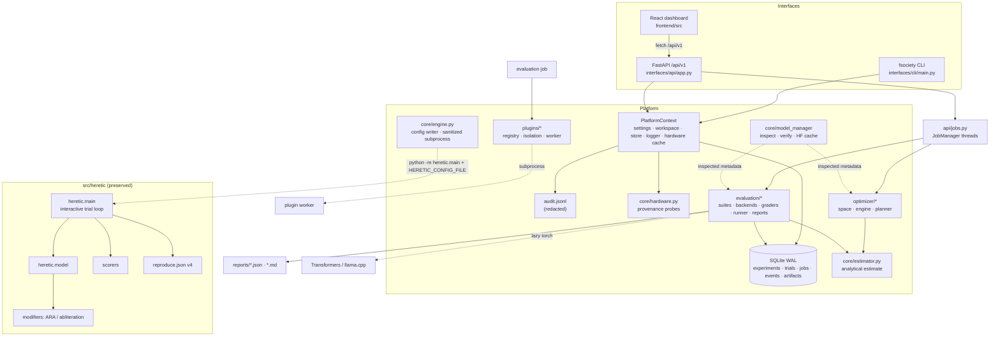
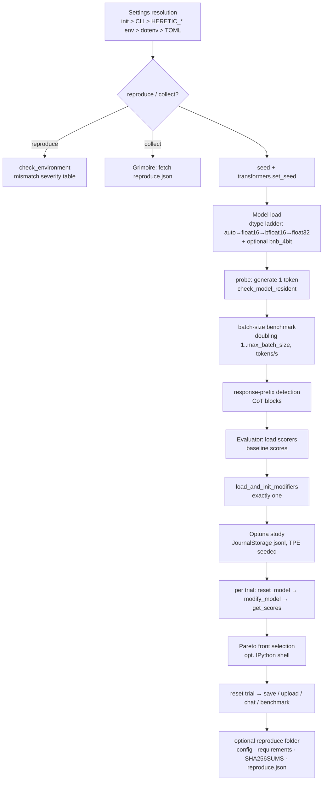
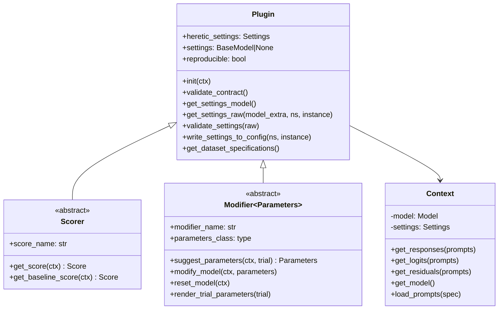

# Initial Technical Audit — HereticFsociety → FSOCIETY AI

- **Audit type:** baseline technical / architectural / security audit before platform consolidation, with a post-remediation reconciliation pass.
- **Repository:** `murdok1982/HereticFsociety` (fork of `p-e-w/heretic`).
- **Commit audited:** `aecd4a845a23be3f96ddc03b37b53a9195ee2566` (`master`, 2026-11-20, "fix: Update model commit for the tiny classifier model (#584)").
- **Upstream base version:** `heretic-llm 2.2.0.dev0` (verified via `git show HEAD:pyproject.toml`).
- **Initial snapshot:** 2026-11-23T10:37Z — dirty tree; `pyproject.toml` modified; `.factory/`, `frontend/`, `src/fsociety/`, `tests/unit/` untracked; 241 commits.
- **Reconciliation snapshot:** 2026-11-23T11:20Z — same commit, tree still dirty but substantially advanced: `src/heretic/_distribution.py` (ADR-011), `docs/guides/`, `deployment/`, 30 test modules, built `frontend/dist`, regenerated `uv.lock`. `dist/` was cleaned after build verification.
- **Auditor:** `@architect` (read-only inspection plus executed test/lint/build/serve commands; no model downloads, no GPU work, no code changes).

---

## 0. Method and evidence

Every statement below is derived from files read in this repository or from commands executed on this machine. No test suite was executed beyond pytest **collection** (collection only imports modules; it downloads nothing). The upstream hash-reproduction harness `tests/run_tests.py` was **not** executed because it downloads models from Hugging Face and mutates them.

Commands actually executed (results quoted in §2, §6, §7, §11):

| Purpose | Command |
| :--- | :--- |
| Line counts | `wc -l` over `src/**/*.py`, `tests/**/*.py`, `frontend/src/**` |
| Snapshot identity | `git rev-parse HEAD`, `git status --porcelain`, `git rev-list --count HEAD` |
| Pre-fork packaging | `git show HEAD:pyproject.toml` |
| Import isolation | `PYTHONPATH=src python3 -c "import fsociety.<module>"` for 19 modules |
| API construction | `import fsociety.interfaces.api.app` (fails, see F-02) |
| Distribution metadata | `importlib.metadata.version("heretic-llm")` when only `fsociety-ai` would be installed |
| Secret scan | 221 text files matched against 6 token regexes (count only, no values printed) |
| Placeholder scan | `grep -rIn 'TODO\|FIXME\|XXX\|NotImplementedError' src/fsociety` |
| CLI smoke | `fsociety version`, `doctor`, `--json hardware`, `hardware --json`, `--json evaluate suites`, `--json security policy` with `FSOCIETY_WORKSPACE=/tmp/opencode/fsociety-audit` |
| Test inventory | `pytest --collect-only -q` (collection only) |

---

## 1. Executive summary

> **Status of this section:** these are the findings of the *initial* snapshot (2026-11-23T10:37Z). The P0/P1 items below marked "resolved" were fixed and re-verified at 11:20Z — see **§1.1 Post-remediation status** for the mapping and evidence. This document keeps the original findings for the record; it is not rewritten to look better in hindsight.

1. **The engine was importable but not runnable after the distribution rename.** `pyproject.toml` declared `fsociety-ai 3.0.0` while `main.py:199`, `system.py:166` and `utils.py:349` resolved the version through `importlib.metadata` for `heretic-llm`; with only `fsociety-ai` installed this raised `PackageNotFoundError` (reproduced). *Resolved* by `src/heretic/_distribution.py` + ADR-011.
2. **The FastAPI application could not be constructed.** `routes/experiments.py:85` annotated `JSONResponse | FileResponse` without `response_model=None`, aborting route registration under FastAPI 0.115.6. *Resolved*; the app now constructs and 14 API tests pass.
3. **The platform layer was (and remains) substantial but largely unverified at that moment.** 18,454 LOC / 73 modules at snapshot; import isolation worked (18 of 19 modules clean, the 19th being the broken API module). It is now 19,459 LOC / 73 modules with 471 LIGHT + 498 ENGINE tests passing.
4. **The dashboard was not buildable.** `App.tsx`, `styles/` and 8 pages were missing. *Resolved*: 12 pages, 10 routes, `frontend/dist` built (2.7 MB), externally browser-verified.
5. **Test coverage was partial and red at collection.** 10 modules, 108 tests collected, 6 collection errors. It is now 30 test modules, 472 collected, 471 passed / 6 skipped in LIGHT and 498 passed / 3 skipped in ENGINE.
6. **No secrets were committed.** 221 files scanned then; 293 files now, 2 matches, both synthetic redaction fixtures in `tests/unit/test_foundation.py`, **0 in `src/`**.
7. **No placeholder code in the platform layer.** `TODO`/`FIXME`/`XXX`/`NotImplementedError` count in `src/fsociety`: **0** (re-measured).

Overall risk posture at the initial snapshot: sound architecture, two P0 defects, several unverified areas. After remediation the P0s and all P1 code defects are closed and the quality gate is green; the remaining honest gaps are Docker (no daemon), GPU paths (no hardware), unattended engine execution (not implemented), security-audit approval (`IN PROGRESS`) and the fact that CI has not been observed running on GitHub (§1.1, §9, §11.2).

### 1.1 Post-remediation status (2026-11-23T11:20Z)

| Finding (initial) | Status | Evidence |
| :--- | :--- | :--- |
| **P0-1** Engine unusable under renamed distribution | **Resolved** | `src/heretic/_distribution.py` aliases `heretic-llm ↔ fsociety-ai`; 3 call sites updated; ADR-011; installed-wheel `heretic --help` → rc 0; metadata reports only `fsociety-ai` |
| **P0-2** `create_app()` fails on a union response annotation | **Resolved** | `import fsociety.interfaces.api.app` succeeds; `tests/api/test_api.py` (14 tests) passes; OpenAPI test present; `/api/v1/health` returns 200 in LIGHT |
| **P1-1** `fsociety hardware --json` rejected | **Resolved** | Both `hardware --json` and `--json hardware` return the same JSON (rc 0); covered by `tests/integration/test_cli.py` |
| **P1-2** Dashboard not buildable | **Resolved** (build not reproducible on this host) | 12 pages / 10 routes; `frontend/dist` 2.7 MB; SPA served by the API (200, `index.html` 696 B); external browser + Lighthouse (a11y 1.0) reported; `node` absent here |
| **P1-3** `max_response_length` derived from context length | **Resolved** | Adapter takes `max_response_length` explicitly (default 100); no `sequence_length` mapping; `tests/unit/test_engine_adapter.py` (16 tests) |
| **P1-4** Engine path never exercised | **Resolved** | Upstream suite: 47 tests OK in ENGINE; `heretic --help` in CI; adapter contract tests; engine profile suite 498 passed |
| **P1-5** Unattended engine runs undefined | **Open** | Trial/export/benchmark selection remains interactive in `heretic/main.py`; no non-interactive path implemented or claimed |
| **P1-6** Platform test modules missing | **Resolved** | `test_model_manager` (19), `test_engine_adapter` (16), `test_evaluation` (27), `test_graders`, `test_regression`, `test_plugins` (31), `test_exporters`, `test_jobs` (4), `tests/security` (157), `tests/api` (14), `tests/integration` (8) |
| **P1-7** Runtime attribution strings inconsistent with fork identity | **Partially resolved** | README rewritten, `CHANGELOG`/`SECURITY`/`CONTRIBUTING` added, headers preserved; the upstream banner still prints heretic-project.org (intentional upstream identity), now documented rather than treated as a defect |
| P2-8 Documentation debt | **Resolved** | 9 guides (1,238 lines), README, changelog, security policy, `.env.example` |
| P3-1 `pydantic` only transitive | **Resolved** | `pyproject.toml` now declares `pydantic>=2.9,<3` explicitly |
| P2-6 CPU confidence field | **Open** | `CpuInfo` has `source` but no `confidence` |

**New findings from this re-verification (not present in the initial audit):**

| ID | Finding | Evidence | Severity / state |
| :--- | :--- | :--- | :--- |
| N-01 | **Quality gate was red at 11:05Z, closed at 11:20Z.** Initially 45 ruff errors (42 pre-existing upstream `E402` in `main.py`, 1 new `E402`, 2 `I001` from the shim) and one unformatted test file. | Now `ruff check --extend-select I src tests` passes and `ruff format --check src tests` reports 144 formatted files; a per-file `E402` ignore documents upstream import order | **Closed** |
| N-02 | **Engine source is no longer byte-identical to upstream.** Three modules changed for the alias shim plus `importorskip` guards in five upstream tests. Behaviour is preserved and documented (ADR-011), but BC-007 must be worded as "no behavioural change beyond the shim", not "no diff". | `git status --porcelain src/heretic` (1 new file) + `git diff --stat aecd4a8 -- src/heretic` (3 modified) | P2 (governance) |
| N-03 | **Light-profile install path diverges from documentation.** CI installs `deployment/docker/requirements-platform.txt` + `--no-deps -e .`; docs describe `pip install ".[api]"`. Two supported paths, one tested. | `.github/workflows/ci.yml` `platform` job | P2 |
| N-04 | **Security audit is not an approval.** `.factory/SECURITY_AUDIT.md` is `IN PROGRESS` with interim 0/0/0/0 and unchecked checklist items; the exit gate cannot be considered met. | `.factory/SECURITY_AUDIT.md` header and §2 checkboxes | P1 (gate) |
| N-05 | **CSP relaxation accepted.** `style-src 'unsafe-inline'` and `font-src`/`img-src data:` were required by inline styles and data-URI fonts (ADR-012). Documented trade-off, weaker than the original header. | ADR-012; live header capture | P3 (accepted) |

---

## 2. Inventory

### 2.1 Heretic engine — `src/heretic` (initial 7,385 LOC; re-measured 7,435 LOC after the ADR-011 shim; 18 non-empty modules)

| Module | LOC | Responsibility |
| :--- | ---: | :--- |
| `main.py` | 1,568 | Interactive orchestrator: settings resolution, Optuna study/journal, trial loop, export (save/upload/chat/benchmark), reproduction/recollection modes, in-context IPython shell. |
| `model.py` | 1,013 | Transformers model/tokenizer loading with dtype ladder and 4-bit fallback, architecture probing (`get_layer_modules` for dense/MoE/hybrid/multimodal), residual/logit/module-I/O extraction, streaming chat. |
| `utils.py` | 810 | Prompt/dataset loading and commit pinning, TOML/config/`requirements.txt`/`reproduce.json` generation, README generation, SHA-256 helpers, HF upload of reproduce folder. |
| `config.py` | 646 | `Settings` (pydantic-settings) with CLI/env/dotenv/TOML sources, plugin config schemas (`ScorerConfig`, `ModifierConfig`, `DatasetSpecification`), `InitOnlySettings`. |
| `system.py` | 478 | Accelerator/driver/CPU detection (CUDA, ROCm, XPU, MLU, SDAA, MUSA, NPU, MPS), cache clearing, distribution version/origin discovery, transitive dependency inventory. |
| `modifiers/abliteration.py` | 466 | Directional ablation modifier: ablation weight kernels, projected abliteration, norm preservation. |
| `plugin.py` | 405 | Plugin loader (file `path.py:Class` or dotted import), `Context` API, `Plugin` base with settings-model contract and reproducibility flag. |
| `modifiers/ara.py` | 396 | Arbitrary-Rank Ablation modifier (default), rank/LoRA-style parameter suggestion and application. |
| `reproduce.py` | 385 | `reproduce.json` v4 loading/validation, environment mismatch severity table, Grimoire collection from the Hub. |
| `scorers/bert_classifier.py` | 276 | Refusal classification scorer using a HF text-classification model. |
| `evaluator.py` | 239 | Scorer loading/initialization, baseline scores, objective names/directions/values, paired score records, settings write-back. |
| `modifier.py` | 185 | `Modifier` ABC (generic over serializable parameters), `ModifierEntry`, `load_and_init_modifiers` (enforces exactly one modifier today). |
| `scorers/keyword_rate.py` | 158 | Default refusal-rate scorer (keyword markers over prompt sets). |
| `scorers/response_length.py` | 101 | Mean response length scorer. |
| `scorers/kl_divergence.py` | 77 | KL divergence between base and modified logits. |
| `scorers/benchmark_score.py` | 77 | Scorer bridging lm-eval task scores into the optimization loop. |
| `scorer.py` | 65 | `Score` dataclass (`value`, `rich_display`, `md_display`) and `Scorer` ABC. |
| `progress.py` | 40 | tqdm/Rich patch (currently disabled in `main.py`, see comment at `main.py:40`). |

Blank `__init__.py` files: `heretic/`, `heretic/modifiers/`, `heretic/scorers/`.

### 2.2 Platform layer — `src/fsociety` (initial snapshot: 18,454 LOC / 73 modules; re-measured 2026-11-23T11:20Z: **19,459 LOC / 73 modules**)

| Group | Modules (LOC) | Total | Responsibility |
| :--- | :--- | ---: | :--- |
| Foundation | `config.py` 232, `context.py` 174, `paths.py` 113, `errors.py` 138, `logging.py` 119 | 776 | Settings (TOML + `FSOCIETY_*`), composition root, path jail, typed error codes, redacted JSONL audit log. |
| Contracts | `core/models.py` 476 | 476 | All shared Pydantic contracts: hardware, model info/validation, estimates, experiments/trials/jobs/events/artifacts, benchmark suites/reports/comparisons, plugin/system info. |
| Hardware | `core/hardware.py` 461 | 461 | Provenance-aware CPU/RAM/GPU detection (`nvidia-smi`, `rocm-smi`, `/proc`, psutil, optional torch), injectable probes, hardware fingerprint. |
| Estimation | `core/estimator.py` 342 | 342 | Analytical weights/KV/activation/overhead model, budget fit, alternatives and recommendations. |
| Engine adapter | `core/engine.py` 797 | 797 | Torch-free status check, Heretic 2.x TOML writer validated against `heretic.config.Settings` fields, argument sanitizer (blocks `--trust-remote-code`), no-shell subprocess launch. |
| Model manager | `core/model_manager/__init__.py` 711, `inspection.py` 1,122, `hf.py` 495 | 2,328 | Safetensors header parsing, config/metadata extraction, compatibility notes, manifests and SHA-256 verification, HF cache discovery and pinned downloads. |
| Optimizer | `optimizer/engine.py` 806, `planner.py` 705, `space.py` 508, `resource_objective.py` 89, `__init__.py` 69 | 2,177 | Declarative search space + presets, seeded Optuna TPE runs with cancellation and SQLite trial persistence, resource objective, execution planning and constraint validation. |
| Evaluation | `graders.py` 843, `runner.py` 598, `backends.py` 559, `suites.py` 393, `regression.py` 378, `lm_eval_adapter.py` 335, `reporting.py` 331, `__init__.py` 102 | 3,539 | 8 deterministic graders, 7 bundled suites, backend abstraction (callable/Transformers/llama.cpp), provenance-carrying reports, comparability checks, lm-eval subprocess adapter. |
| Experiments | `experiments/store.py` 566 | 566 | SQLite WAL store: experiments, trials, jobs, events, artifacts; schema versioning. |
| Plugins | `api.py` 375, `isolation.py` 500, `registry.py` 559, `worker.py` 269, `scorers/*` 1,015 | 2,718 | Versioned plugin API v1, discovery (builtin/entry-point/workspace), subprocess isolation with env allowlist and rlimits, 7 example scorer plugins. |
| Security | `policy.py` 254, `sbom.py` 185, `redaction.py` 117, `findings.py` 104, `headers.py` 44 | 704 | Trust policy, API access policy, secret redaction, configuration findings, CycloneDX SBOM + pip-audit wrapper, HTTP security headers. |
| Exporters | `manifest.py` 338, `gguf.py` 268, `__init__.py` 27 | 633 | Verifiable export bundles with SHA-256 manifests; GGUF metadata boundary (no conversion). |
| HTTP API | `jobs.py` 221, `app.py` 189, `auth.py` 142, `schemas.py` 107, `errors.py` 101, `middleware.py` 95, `deps.py` 91, `routes/*` 810, `__init__.py` 10 | 1,766 | FastAPI v1 app (35 route handlers), API-key auth, rate limiting, body cap, structured errors, durable job manager, SPA serving. |
| CLI | `interfaces/cli/main.py` 1,092 | 1,092 | `fsociety` command tree: 13 command groups (see §3.4). |
| Utilities | `utils/hashing.py` 79 | 79 | SHA-256 for text/bytes/files/dirs and canonical config hashing. |

Reconciliation note: `security/` now holds `policy.py`, `sbom.py`, `redaction.py`, `findings.py`, `headers.py` (no separate `security/audit` module — auditing is split as described); `docs/` now contains `audit/`, `sdd/`, `guides/` and the upstream migration guide, but still no `docs/reports/`.

### 2.3 Tests, frontend, packaging, docs (initial snapshot with post-remediation deltas)

| Area | Initial snapshot (10:37Z) | Re-measured (11:20Z) |
| :--- | :--- | :--- |
| Upstream tests | 6 modules: `test_config.py` (18), `test_plugin.py` (11), `test_chat_template.py` (8), `test_ara_lowrank_equivalence.py` (4), `test_keyword_rate.py` (3), `test_residual_streams.py` (3); 5 required torch | Same 6 modules, now with `pytest.importorskip("torch")`; **47 tests OK** in ENGINE |
| Platform tests | `test_foundation.py` (29 functions), `test_optimizer.py` (18), `test_planner.py` (16), `tests/api/test_api.py` (13) | 30 modules: unit (foundation 32 collected, optimizer, planner, model_manager 19, engine_adapter 16, evaluation 27, graders, regression, plugins 31, exporters, jobs 4), api (14), security (157), integration (8) |
| Collection result | 108 collected, 6 errors | **472 collected**, 0 errors; LIGHT **471 passed / 6 skipped**; ENGINE **498 passed / 3 skipped** |
| Frontend | 33 files / 3,535 LOC; `App.tsx` and `styles/` missing; no `dist/` | 48 files / 11,718 LOC (ts/tsx/css); 12 pages, 10 routes; **`dist/` 2.7 MB**; Node still absent on this host |
| Packaging | hatchling wheel with both packages; no build verified | `uv build` verified: wheel 319 KB, 22 `heretic/` + 81 `fsociety/` entries, 8 benchmark JSONs, both console scripts; `uv.lock` regenerated |
| Docs | Only `docs/migration_v1_to_v2.md` | 9 guides (1,238 lines), README rewritten (9,727 B), `CHANGELOG`, `SECURITY`, `CONTRIBUTING`, `.env.example`; `docs/reports/` still absent |
| Deployment | none | `deployment/docker/{Dockerfile,docker-compose.yml}`, `deployment/scripts/install.sh` (image build **unverified**: no Docker daemon) |

---

## 3. Architecture and data flow

### 3.1 Current component topology

Key structural fact: **the platform never imports the engine at module scope**. `core/engine.py` launches `python -m heretic.main` (or a bootstrap `-c`) in a subprocess with a sanitized environment and a generated TOML config. The only place torch is imported is behind `importlib.util.find_spec` guards (`core/hardware.py:232`, `evaluation/backends.py:141`).

### 3.2 Heretic engine execution flow (as implemented upstream)

Observation: the loop is **interactive by construction** (`questionary` prompts for checkpoint action, trial choice, export strategy, upload visibility, benchmark scope). Only a subset is overridable via settings (`trial_index`, `model_action`, `export_strategy`, `checkpoint_action`). Trial selection and benchmark selection have no non-interactive equivalent, which constrains unattended automation through the engine adapter.

### 3.3 Plugin, modifier and scorer contracts

Platform-side contract is different and versioned (`PLUGIN_API_VERSION = 1`, `src/fsociety/__init__.py`): `PluginBase` with kinds `scorer | modifier | evaluator | hardware_provider | exporter | integration`, declarative metadata (`name`, `version`, `api_version`, `permissions`, `dependencies`), and a worker invocation protocol used by `plugins/isolation.py` (subprocess, env allowlist, timeout, output cap, optional `unshare -n`).

### 3.4 Entry points

| Entry point | Definition | Verified |
| :--- | :--- | :--- |
| `heretic` | `[project.scripts] heretic = "heretic.main:main"` | Declared. Startup path fails under renamed distribution (F-01). |
| `fsociety` | `[project.scripts] fsociety = "fsociety.interfaces.cli.main:entrypoint"` | `python -m fsociety.interfaces.cli.main version` → `FSOCIETY AI v3.0.0`, exit 0. |
| CLI groups | `version`, `doctor`, `hardware`, `models {list,scan,inspect,verify,estimate,download}`, `optimize run`, `evaluate {suites,run,report,compare}`, `experiments {list,show,trials,export}`, `plugins {list,run,validate}`, `security {policy,findings,audit,sbom,deps}`, `export bundle`, `serve`, `config {init,show}`, `engine {status,run}` | Parser at `interfaces/cli/main.py:903-1037`. |
| HTTP API | `create_app()` → 35 route handlers under `/api/v1` | Constructs after remediation; 14 API tests pass; `/api/v1/health` 200 in LIGHT. |
| Engine subprocess | `core/engine.py:build_engine_command()` → `python -m heretic.main` | Requires torch/transformers/optuna; unavailable here. |

---

## 4. Strengths worth preserving

1. **Determinism engineering in the engine.** Fixed chat-template clock (`model.py:99`, `strftime_fixed_date`), greedy decoding (`do_sample=False`, `model.py:639`), zero-initialized LoRA A and B (`_zero_lora_weights`), seeded `transformers.set_seed`, Optuna TPE with explicit seed, journal-based study resumption. This is the property the whole platform's provenance story depends on.
2. **Explicit reproducibility envelope.** `reproduce.json` v4 carries settings (including seed), parameter set, paired scores, environment (heretic origin/commit, PyTorch version, transitive requirements), optional system info, and weight hashes; mismatch severity is graded (`reproduce.py:131-172`) instead of being reduced to a boolean. `generate_reproduce_readme` (`utils.py:422`) documents exactly which factors break byte-identical reproduction.
3. **Plugin system with a real settings contract.** Settings schemas are discovered from type annotations, namespaced per class and per instance (`scorer.<Class>_<instance>`), validated, and written back before serialization (`plugin.py:271-379`). Plugin authors never edit package code.
4. **Interactive UX that explains cost before acting.** Quantized-merge warning with meta-device footprint probe (`main.py:126-170`), batch-size benchmark reported as tokens/s, memory reporting per phase, exhaustive upstream error messages (e.g. `check_model_resident` lists remedies).
5. **Platform architectural discipline.** Typed errors with stable codes and HTTP mapping (`errors.py`), a single composition root with lazy components (`context.py`), a path jail that resolves symlinks before comparison (`paths.py:22-49`), `extra="forbid"` contracts at trust boundaries (`core/models.py:38`), no torch at module scope, and zero placeholder markers in 18.4k LOC.
6. **Honest failure semantics.** Hardware detection records warnings instead of raising (`core/hardware.py:370-382`); SBOM/dependency audit reports `unavailable` instead of inventing results (`security/sbom.py`); estimates carry `kind="estimate"` and explicit assumptions (`core/models.py:238`, `core/estimator.py:181-190`); the LLM-free benchmark suites state they are smoke suites, not official benchmarks (`evaluation/suites.py:12-14`).
7. **Operational safety defaults.** Loopback bind, deny-by-default remote code, no-shell subprocess launches, allowlisted env for engine and plugins, constant-time API-key comparison (`security/policy.py:226-234`), and security headers applied by middleware (`api/middleware.py:29`).

---

## 5. Weaknesses and gaps (prioritized)

### P0 — release-blocking (initial snapshot)

| ID | Status | Finding | Evidence |
| :--- | :--- | :--- | :--- |
| P0-1 | **Resolved** (ADR-011) | **Engine CLI could not start under the renamed distribution.** `heretic` resolved its version from distribution `heretic-llm`, which no longer exists once `fsociety-ai` is installed. Uncaught `PackageNotFoundError` at banner print → process exits before any work. | Was: `pyproject.toml:2`, `main.py:199`, `system.py:166-169`, `utils.py:349`. Now: `src/heretic/_distribution.py` + 3 call sites; `heretic --help` rc 0 |
| P0-2 | **Resolved** | **FastAPI app failed to import.** `JSONResponse \| FileResponse` return annotation treated as a response model, aborting route registration. Blocked `serve`, API tests, SPA and any container health check. | Was: `routes/experiments.py:85`. Now: app imports; 14 API tests pass; OpenAPI test present; `/api/v1/health` 200 in LIGHT |

### P1 — major (initial snapshot)

| ID | Status | Finding | Evidence |
| :--- | :--- | :--- | :--- |
| P1-1 | **Resolved** | `fsociety hardware --json` rejected `--json` (global flag only). | Now accepted in both positions for all read commands; `tests/integration/test_cli.py` |
| P1-2 | **Resolved** (build not reproducible here) | Dashboard could not build: missing `App.tsx`, `styles/`, 8 pages, no `dist/`. | Now 12 pages / 10 routes, `dist/` 2.7 MB, SPA served 200; external Lighthouse a11y 1.0; `node` absent on this host |
| P1-3 | **Resolved** | Engine config writer conflated context length with generation length (`max_response_length = sequence_length`). | Adapter now takes `max_response_length` explicitly (default 100), no sequence mapping; `tests/unit/test_engine_adapter.py` (16) |
| P1-4 | **Resolved** | Engine path never exercised: 5/6 upstream modules required torch; no start/config acceptance test. | Upstream 47 tests OK in ENGINE; `heretic --help` in CI and locally; adapter contract tests |
| P1-5 | **Open** | Unattended engine runs are not achievable: trial selection, export strategy and benchmark selection are interactive-only. | `heretic/main.py:879-888, 1006-1044, 1436-1464`; recorded as "not promised" #7 |
| P1-6 | **Resolved** | Missing platform tests for model manager, engine adapter, evaluation, graders, regression, plugins, exporters, security. | 30 test modules; counts in `01_REQUIREMENTS.md` §10 |
| P1-7 | **Partially resolved** | Version/attribution inconsistency: runtime strings still reference `heretic-llm`/heretic-project.org while metadata points at the fork. | README/CHANGELOG/SECURITY/CONTRIBUTING added; banner intentionally upstream; documented in ADR-011 |

### P2 — moderate

| ID | Status | Finding | Evidence |
| :--- | :--- | :--- | :--- |
| P2-1 | Open | **Global mutable settings in the engine.** `settings.model`, `batch_size`, `response_prefix`, `n_trials`, `export_strategy` are mutated at runtime and passed to plugins; a plugin holding a reference observes later mutations. Platform adapter mitigates by generating a fresh config per run. | `heretic/main.py:479, 545, 639, 915, 1332-1334` |
| P2-2 | Open | **Config location is cwd-coupled.** Default `config.toml` in the process working directory; `HERETIC_CONFIG_FILE` must point to an existing file or the process exits (`SystemExit`). The platform works around this with `_working_directory()`/`write_platform_config`, but the coupling remains a footgun for services. | `heretic/config.py:194-200`, `core/engine.py` |
| P2-3 | Open (accepted) | **Rate limiting is per-process, in-memory.** Multi-worker deployments would multiply the effective limit. | `api/auth.py`; documented limitation |
| P2-4 | Open (accepted) | **Single SQLite connection guarded by an `RLock`.** Serializes writes globally; no migration path (schema mismatch raises `ConflictError`). | `experiments/store.py`; ADR-004 |
| P2-5 | Open | **Estimator constants are uncalibrated.** Bytes/param, 8% fragmentation, 600 MiB CUDA context, 2× activation factor and the KV fallback are heuristics with no measured calibration on this hardware. | `core/estimator.py` |
| P2-6 | Open | **Hardware provenance is uneven.** `GpuInfo` has `source` + `confidence`; `CpuInfo` has only `source`. AC-04 satisfied at profile level, not per field. | `core/models.py:63-71` |
| P2-7 | Open (documented) | **Plugin isolation is best-effort.** Process + rlimit + env allowlist; `unshare -n` usually unavailable; not a sandbox. | `plugins/isolation.py`; `SECURITY_AUDIT.md` non-goals |
| P2-8 | **Resolved** | **Documentation debt.** | 9 guides (1,238 lines), README, changelog, security policy, `.env.example`; `docs/reports/` still absent (FR-036) |

### P3 — minor

| ID | Finding | Evidence |
| :--- | :--- | :--- |
| P3-1 | ~~`pydantic` not declared directly~~ — **resolved**: `pydantic>=2.9,<3` is now a direct dependency. | `pyproject.toml` |
| P3-2 | Global logger named `fsociety` accumulates handler state across `PlatformContext` instances in a single process (tests/API reloads). | `logging.py:37-42` |
| P3-3 | `python-version` file says `3.12`, `.python-version` in CI is irrelevant (matrix-driven), and the local `.venv/` has no interpreter — onboarding friction, not a code defect. | `.python-version`, `.venv/` |
| P3-4 | Buffers/duplicates: `plugins/scorers/__init__.py` exports 7 scorers while `doctor` reports "7 discovered"; adding a builtin must be done in two places (package index + registry iteration). | `plugins/scorers/__init__.py`, `plugins/registry.py:65` |
| P3-5 | Frontend package scripts hardcode `node ./node_modules/...` instead of npm script shims, so `npm run build` requires `node` on `PATH` and bypasses npm's bin resolution. | `frontend/package.json:8-11` |

---

## 6. Security findings

Severity reflects **this repository as deployed today**, not the upstream project's threat model. Secret values were never printed; the scan reported counts only.

| ID | Severity | Finding | Assessment / status |
| :--- | :--- | :--- | :--- |
| F-SEC-01 | **HIGH** | **Dynamic plugin import executes arbitrary code by design.** `load_plugin` imports a dotted module or executes an arbitrary `.py` file (`spec.loader.exec_module`). Any config file is therefore a code-execution vector. | Accepted upstream design. Platform mitigates with `plugins/isolation.py` (subprocess, env allowlist, timeout, output cap, optional netns) for platform plugins; the engine's own plugin loader remains code-execution-by-config. Documented boundary required. |
| F-SEC-02 | **HIGH** | **`trust_remote_code` has no non-interactive policy upstream.** The engine passes `trust_remote_code=True` after the user accepts Transformers' interactive prompt, then caches the repo in-process (`trusted_models`). There is no allowlist, no deny default, and no way to pre-seed consent safely (only the implicit prompt). | Mitigated at the platform boundary: `trust_remote_code` defaults to `"never"`, `TrustPolicy.ensure_remote_code` requires exact `org/name` allowlist entries, and `core/engine.py` refuses `--trust-remote-code` flags. Direct `heretic` usage remains unprotected. |
| F-SEC-03 | **MEDIUM** | **Optional in-context IPython shell** (`enable_shell`, default `False`). When enabled it exposes `settings`, `model`, `study` and full Python with no sandbox and says so. | Acceptable as opt-in. Platform-generated configs always set `enable_shell = False` (`core/engine.py:616`). Keep the warning text; do not expose via API. |
| F-SEC-04 | **MEDIUM** | **Upload credentials handling.** Tokens come from `huggingface_hub.get_token()` (env `HF_TOKEN` or token file) or an interactive password prompt; tokens are deliberately not part of `Settings` and are not written to reproduce artifacts. `whoami` prints full name and e-mail. | Reasonable. Residual risk: environment-based tokens are visible to child processes. Note the platform deliberately excludes `HF_TOKEN` from both env allowlists (`core/engine.py:92`, `plugins/isolation.py:48`), so gated-model access through platform-launched subprocesses requires an explicit, future opt-in — a security decision with a usability consequence to document. |
| F-SEC-05 | **MEDIUM** | **No hardware abstraction independent of torch.** Upstream accelerator detection lives in `system.py` and imports torch at module scope; there is no CPU-only path, no provenance, and no way to plan on a machine that cannot import torch. | Resolved in the platform (`core/hardware.py`), which never imports torch at module scope and degrades with warnings. Upstream remains torch-coupled. |
| F-SEC-06 | **MEDIUM** | **No model manager or integrity tooling upstream.** Models are loaded by ID from cache/Hub with optional `model_commit`; there is no local inventory, no hash manifest, no verification command outside the test harness. | Resolved in the platform (`core/model_manager`: safetensors headers, manifests, `verify`, pinned downloads). Not wired into the engine path. |
| F-SEC-07 | **MEDIUM** | **Evaluation only at the end of a run, via lm-eval.** Benchmarks run after trial selection, against the in-memory model, with `lm_eval.simple_evaluate`; results are printed to a Rich table and not persisted with provenance. | Platform adds suites/graders/reports/regression. Upstream benchmark results remain non-reproducible artifacts. |
| F-SEC-08 | **LOW** | **Secret scan:** 221 files scanned; 7 pattern matches, all synthetic fixtures in `tests/unit/test_foundation.py` used to assert redaction; 0 in `src/`. No `.env`, `*.pem`, `id_rsa*` or `*secret*` files outside `.git`. | Pass. Redaction is applied on audit-log write (`logging.py:72-73`) and on API report responses (`routes/experiments.py:106`). |
| F-SEC-09 | **LOW** | **API surface absent upstream**; present in platform. After remediation the app constructs and 14 API tests pass. Auth policy is fail-closed: non-loopback without a configured key → 403; missing key → 401; constant-time compare. | Resolved (P0-2 closed). CSP relaxed for inline styles/data fonts per ADR-012 — documented trade-off. |
| F-SEC-10 | **LOW** | **No secret values in docs/configs.** `config.default.toml` and all `config.*.toml` contain settings only. `api_key` is `SecretStr` and excluded from `redacted()`. | Pass. |
| F-SEC-11 | **LOW** | **Subprocess surfaces:** engine launch is `shell=False` with an env allowlist and meta-character rejection (`core/engine.py:312-339`); plugin worker uses `start_new_session` and process-group kill. | Pass with the documented limitation that plugins are trusted-ish code. |
| F-SEC-12 | **INFO** | **Supply chain:** CycloneDX 1.5 SBOM built from installed distributions; `pip-audit` invoked only if present, otherwise reported unavailable. `uv.lock` is 1,047,860 bytes and not audited here. | Acceptable; add `pip-audit` to CI. |

---

## 7. Performance observations

These are code-level observations, not benchmarks. No model was loaded on this machine (no torch, CPU-only).

1. **Meta-device footprint probe before quantized merges** (`heretic/main.py:139-170`). Loading the architecture on `device_map="meta"` with `torch_dtype=bfloat16` yields `get_memory_footprint()` without allocating weights, then falls back to the "≈3× parameter count in GB" rule of thumb if meta loading fails. Cost: one config load + module instantiation; benefit: prevents an OOM system freeze during dequantizing merges. This is the only place the code estimates memory, and it estimates only weights, not KV cache or activations.
2. **KV cache deliberately disabled for module I/O and residual/logit extraction.** `get_residuals`, `get_module_io`, `get_logits` all pass `use_cache=False` with `max_new_tokens=1`, because only the last prompt position is needed. This trades a small amount of compute for bounded memory; the dtype-probe generation in `Model.__init__` intentionally keeps the cache enabled to catch cache-related dtype failures (`model.py:230-242`).
3. **Batch size is chosen by measurement, not estimation** (`main.py:419-480`). Batch sizes 1, 2, 4, 8 … up to `max_batch_size` are each warmed once, then timed once; throughput is `sum(len(encode(response))) / elapsed`, and the best value wins. Consequences: two full generations per candidate, no repetition/median, no confidence interval, and the winner can be noisy on shared hardware; error at batch 1 is fatal, errors at larger batches stop the search.
4. **Dtype fallback ladder re-runs a full generation per attempt** (`model.py:196-258`). Each dtype attempt loads the model and generates one token; each failure clears the cache (`empty_cache`) before the next. On a large model this can mean multiple multi-minute loads. Defaults are `auto → float16 → bfloat16 → float32`, and 4-bit quantization config is recomputed per attempt.
5. **Host/device traffic is traded for VRAM.** `offload_outputs_to_cpu=True` moves residuals and logits to CPU and empties the cache after extraction; `get_module_io` clones every hooked module's input/output to CPU (`model.py:840-841`). For MoE models this is O(layers × experts × batch) host transfers per batch.
6. **Global write serialization in the store.** One SQLite connection with WAL and an `RLock`; readers are non-blocking, writers serialize. With `JobManager(max_workers=2)` this is adequate; it will not scale to many concurrent jobs.
7. **Rate limiter is O(window) per key with periodic cleanup**, in-memory, per process (`api/auth.py:98-133`). Cheap and correct for one process.
8. **Estimator is O(1)** with a bounded search for recommendations: ≤6 candidate modes when the request does not fit, or ≤7 batch candidates (2..32) when it does (`core/estimator.py:209-310`).

---

## 8. Compatibility constraints

| Constraint | Detail | Must not break |
| :--- | :--- | :--- |
| Engine config keys | `heretic.config.Settings` field names, including plugin tables `[scorer.<Class>]`, `[scorer.<Class>_<instance>]`, `[modifier.<Class>]`. `model_extra` must stay `allow` so plugin settings survive validation. | `config.default.toml`, `config.emotions.toml`, `config.nohumor.toml`, `config.noslop.toml`, `config.nosyco.toml`, `config.piqa.toml`, `config.terse.toml`, `config.classifier.toml` |
| Heretic 2.x migration semantics | 1.x keys are invalid: `print_residual_geometry`, `plot_residuals`, `kl_divergence_scale/target`, `chain_of_thought_skips`; abliteration settings moved under `[modifier.Abliteration]`. | `docs/migration_v1_to_v2.md` |
| Plugin contracts | File form `path/to/plugin.py:Class` or dotted `module.Class`; must subclass `Scorer`/`Modifier`; must not define `__init__`; optional `settings: BaseModel` annotation; `init(ctx)` hook; `reproducible` flag gates reproducibility offers. | Third-party plugins published for Heretic 2.x |
| Scorer output | `Score(value: float, rich_display: str, md_display: str)`; objective order must match `directions` positional order (`evaluator.py:193-232`). | Optuna studies and journals |
| CLI contract | `heretic [MODEL]` positional shorthand, `--reproduce`, `--collect-reproducibles`, `HERETIC_CONFIG_FILE`; `fsociety <command>` tree. | User scripts, docs, CI |
| Reproduction manifest | `reproduce.json` **version 4** only; v1–v3 rejected with an explicit message. Fields: `settings`, `parameters`, `scores`, `hashes`, `environment`, optional `system`. | Grimoire corpus and `--reproduce` |
| Reproducibility preconditions | Model and datasets must be HF repo ids, datasets commit-pinned, all scorers `reproducible` and builtin, modifier builtin, not already in reproduction mode (`main.py:1191-1202`). | Model cards tagged `reproducible` |
| Distribution metadata | Engine expects distribution `heretic-llm`; platform expects `fsociety-ai`. **Reconciled** by `src/heretic/_distribution.py` (ADR-011), which resolves aliases both ways while preserving manifest keys. | Install/upgrade |
| Import boundaries | `import fsociety` and `fsociety.interfaces.api` must not import torch; engine-dependent code imports lazily. | Light-profile installs, API-only hosts |
| Python support | `requires-python >=3.10`; CI matrix 3.10–3.15; code avoids 3.11+ syntax where noted (`tomli` fallback, `hashlib.file_digest` TODO). | Packaging |

---

## 9. Risk register

| ID | Risk | Likelihood | Impact | Severity | Mitigation | Owner |
| :--- | :--- | :--- | :--- | :--- | :--- | :--- |
| R-01 | Users install the fork and `heretic` is unusable → trust loss on first contact | High | High | **Critical** | Fix distribution-name lookups (accept both names) or publish `heretic-llm` metadata; add a start-up smoke test; revise ADR-007 | `@builder` |
| R-02 | API cannot boot → dashboard, Docker and integration tests all blocked | Certain (today) | High | **Critical** | `response_model=None` on the union-return route; add `test_app_imports` | `@builder` |
| R-03 | Engine integration drifts silently (config keys, flags, prompts) | High | High | High | Contract test: generated TOML validated against `heretic.config.Settings`; `--help` parse test; golden config snapshot | `@qa-verifier` |
| R-04 | Fake or mislabeled benchmark numbers reach users | Medium | High | High | Keep `kind="estimate"`/smoke-suite labels; block comparisons when suite/grader/model differ; report test-double backend explicitly | `@architect` / `@redteam-auditor` |
| R-05 | Plugin executes hostile code on the host | Medium | High | High | Keep subprocess isolation; never claim sandboxing; require explicit `plugin_allow_network` | `@redteam-auditor` |
| R-06 | `trust_remote_code` enabled through config drift | Low | Critical | High | Deny default, exact allowlist, engine flag blocker, config findings, CI grep for `trust_remote_code=True` | `@redteam-auditor` |
| R-07 | Dashboard ships with mock data or missing states | Medium | Medium | Medium | AC-32 test; API-offline state review; forbid fixtures in `src/` | `@ui-artisan` |
| R-08 | SQLite corruption under concurrent job writes | Low | High | Medium | WAL + RLock + single connection; add concurrency test; document single-process limit | `@builder` |
| R-09 | Estimates used as measurements (OOM in production) | Medium | Medium | Medium | Persistent `kind="estimate"`, assumptions in every surface, calibration task before claims | `@architect` |
| R-10 | Missing tests let regressions through (AC-10..27 unverified) | High | Medium | Medium | Build the named test modules; enforce exit gate | `@qa-verifier` |
| R-11 | Reproducibility promises fail across GPUs/drivers | Medium | Medium | Medium | Keep mismatch severity table; document "byte-identical requires identical stack" | `@architect` |
| R-12 | CI matrix 3.10–3.15 breaks on unavailable wheels/torch | Medium | Low | Low | Split light-profile matrix (3.10–3.14) from engine matrix; pin torch index | `@builder` |
| R-13 | Upstream merge conflicts as Heretic evolves | Medium | Medium | Medium | Keep engine changes limited to the ADR-011 alias shim; isolate all platform behaviour in adapters; record upstream commit | Orchestrator |
| R-14 | Secrets leak via logs/reports | Low | High | Medium | Redaction on write (including on-disk reports), tests with synthetic tokens, secret scan in CI | `@redteam-auditor` |

**Reconciliation (11:20Z):** R-01 **closed** (ADR-011, `heretic --help` rc 0); R-02 **closed** (`create_app` + 14 API tests); R-03 **reduced** (16 adapter contract tests; no golden-config snapshot); R-07 **reduced** (dashboard built and externally reviewed; API-offline state needs re-check at delivery); R-10 **closed** (30 test modules, 472 collected); R-12 **mitigated** (CI split into platform/quality/engine/frontend jobs). R-08/R-11 remain open as documented limitations. N-01 (quality gate) was opened and closed within the same window: gates are green as of 11:20Z. The remaining gate risk is that the CI workflow itself has not been observed running on GitHub.

---

## 10. Prioritized recommendations (P0 → P4)

### P0 — before any feature work continues
1. ~~**Restore engine startup.**~~ **DONE (ADR-011)** — `_distribution.get_version()` resolves `heretic-llm` → `fsociety-ai`; `heretic --help` rc 0 with only `fsociety-ai` installed.
2. ~~**Fix the API response annotation.**~~ **DONE** — app constructs; `tests/api` (14) green; OpenAPI test present.
3. ~~**Re-run collection and require green.**~~ **DONE** — 472 collected, 0 errors; LIGHT 471 passed / 6 skipped.

### P1 — required for the SPEC exit gate
4. ~~Accept `--json` after the subcommand.~~ **DONE** — both positions verified; CLI tests added.
5. ~~Complete the dashboard shell and produce a build.~~ **DONE** — 12 pages / 10 routes, `dist/` built, SPA served; API-offline state verified externally, re-check at delivery.
6. ~~Split `sequence_length` from `max_response_length`.~~ **DONE** — explicit `max_response_length`; adapter tests.
7. ~~Implement the missing platform test modules.~~ **DONE** — 30 modules; see `01_REQUIREMENTS.md` §10.
8. **Define and test the unattended engine path** — **OPEN**; remains an explicit non-promise.
9. **Make the quality gate green** (new) — 3 new ruff errors and 1 unformatted test file are attributable to recent changes; `ruff check`/`ruff format --check` must pass before the exit gate.

### P2 — production hardening
9. Add per-field `confidence` to `CpuInfo` and a `detection_mode`/warnings per source; expose provenance in the dashboard.
10. Calibrate the estimator against at least one measured loading (requires a machine with torch); until then keep `kind="estimate"` and never publish "fits" as a guarantee.
11. Document and test rate-limit/job-manager single-process semantics; fail loudly if `uvicorn --workers > 1` is used.
12. Add schema migration tooling or a documented "new workspace" path for `SCHEMA_VERSION` bumps.
13. Write the full documentation set (install, quickstart, architecture, CLI, API/OpenAPI, config, plugins, optimizer, benchmarks, security, troubleshooting) and replace the upstream README origin story with a fork-specific one while keeping attribution.

### P3 — polish
14. Declare `pydantic` explicitly; pin FastAPI/pydantic ranges that are actually tested.
15. Consolidate logger handler creation; make `AuditLogger` idempotent per process.
16. Remove the hardcoded `node ./node_modules/...` form in `frontend/package.json`; use the standard binaries so `npm run build` works with any package manager.
17. Deduplicate plugin index registration (single source of truth for builtin scorers).

### P4 — research / optional
18. Multi-modifier support (upstream currently enforces exactly one) and multi-objective strategy presets.
19. GGUF conversion (currently metadata-only boundary) via an external tool, behind an explicit capability check.
20. Remote/multi-host execution: split "planning host" from "GPU worker" using the existing engine adapter boundary.

---

## 11. Verification log

### 11.1 Initial snapshot (2026-11-23T10:37Z)

| Check | Result |
| :--- | :--- |
| `import fsociety`, `config`, `paths`, `core.models`, `core.hardware`, `core.estimator`, `experiments.store`, `plugins.api`, `plugins.registry`, `evaluation.graders`, `evaluation.suites`, `optimizer.space`, `optimizer.planner`, `core.model_manager`, `interfaces.cli.main`, `security.redaction`, `exporters.manifest` | OK; no `torch`/`transformers`/`optuna`/`fastapi` in `sys.modules` after a clean import of each module (verified individually in fresh processes). |
| `import fsociety.interfaces.api.app` | **FAIL** at that time — `FastAPIError: Invalid args for response field ... JSONResponse \| FileResponse`. |
| `python -m fsociety.interfaces.cli.main version` | `FSOCIETY AI v3.0.0`, Plugin API v1, engine unavailable, exit 0. |
| `... doctor` | 11 checks: python/workspace/database/hardware/trust_policy/plugins ok; hardware warning ×2, engine warn, dashboard warn (no build), api_auth warn (loopback only); 7 plugins discovered, 0 invalid. |
| `... --json hardware` | Valid `HardwareProfile` JSON: `cpu.source=measured`, `detection_mode`, fingerprint, 2 warnings, `torch.installed=false`. |
| `... hardware --json` | **FAIL** at that time — `unrecognized arguments: --json` (P1-1). |
| `... --json evaluate suites` | 7 suites, 72 items total. |
| `... --json security policy` | `mode=never`, `default_policy=deny`, `remote_code_allowed=false`, `plugin_isolation=true`, `plugin_allow_network=false`. |
| `pytest --collect-only -q` | 108 tests collected, **6 errors** (5 torch-dependent modules + the API defect). |
| `importlib.metadata.version("heretic-llm")` | `PackageNotFoundError` — the failure mode that would hit a `fsociety-ai`-only install. |
| Secret regex scan (221 files) | 7 matches, all `tests/unit/test_foundation.py` fixtures; 0 in `src/`. |
| `grep TODO/FIXME/XXX/NotImplementedError src/fsociety` | 0 / 0 / 0 / 0. |
| `tests/run_tests.py` | **Not executed** (downloads and mutates HF models). |
| `npm run build` / typecheck | **Not executable** at that time (no Node, no `dist/`). |
| Engine run | **Not executed** (no torch/transformers/optuna). |

### 11.2 Post-remediation re-verification (2026-11-23T11:20Z)

| Check | Command | Result |
| :--- | :--- | :--- |
| LIGHT suite | `PYTHONPATH=src /tmp/opencode/fsociety-venv/bin/python -m pytest tests -q -m "not gpu and not engine"` | **471 passed, 6 skipped**, 3 subtests, 31.97s |
| ENGINE suite | `/tmp/opencode/engine-env/bin/python -m pytest tests -q -m "not gpu"` | **498 passed, 3 skipped**, 5 subtests, 48.04s |
| Upstream suite | `/tmp/opencode/engine-env/bin/python -m unittest discover -s tests -p 'test_*.py'` | **47 tests OK** |
| Collection | `pytest tests --collect-only -q` | **472 collected**, 0 errors, 30 modules |
| Engine CLI | `/tmp/opencode/engine-env/bin/heretic --help` | usage printed, **rc 0**; installed distribution = `fsociety-ai` only |
| CLI JSON (both positions) | `fsociety <cmd> --json` and `fsociety --json <cmd>` | rc 0 for version/hardware/models/security/evaluate/plugins/config/experiments; `engine status --json` rc 1 with structured error |
| API + SPA | `serve` on 127.0.0.1:8127 + curl | `/api/v1/health` 200, `/api/v1/version` 200, `/` 200 (`dist/index.html`, 696 B), `/api/v1/models` 200 loopback, `/api/openapi.json` 200 (OpenAPI 3.1.0), `/api/docs` 200 |
| Security headers | `curl -sI /api/v1/health` | CSP (ADR-012), nosniff, DENY, no-referrer, permissions, COOP, CORP |
| Wheel | `uv build --out-dir /tmp/opencode/dist-check` | wheel 319 KB + sdist; 22 `heretic/` + 81 `fsociety/` entries; 8 benchmark JSONs; both console scripts |
| Secret scan | 293 files, 6 regexes | 2 matches, both synthetic fixtures; **0 in `src/`** |
| Placeholder scan | `grep -rIn 'TODO\|FIXME\|XXX\|NotImplementedError' src/fsociety` | **0** |
| Lint format | `ruff format --check src tests` | **GREEN** — 144 files formatted (was red at 11:05Z) |
| Lint rules | `ruff check --extend-select I src tests` | **GREEN** — all checks passed (per-file `E402` ignore for `src/heretic/main.py`) |
| Types | `ty check src/fsociety --ignore import-not-found` | 1 warning (`core/hardware.py:121`), no errors |
| Frontend rebuild | `npm run build` | **Skipped (environment)** — no Node; artifact inspected instead |
| Docker build | `docker build -f deployment/docker/Dockerfile .` | **Skipped (environment)** — no daemon |
| Reproduction harness | `tests/run_tests.py` | **Not executed** (downloads and mutates HF models; requires network + disk) |
| GPU paths | `pytest -m gpu` | **Skipped (environment)** — no GPU/torch here |
