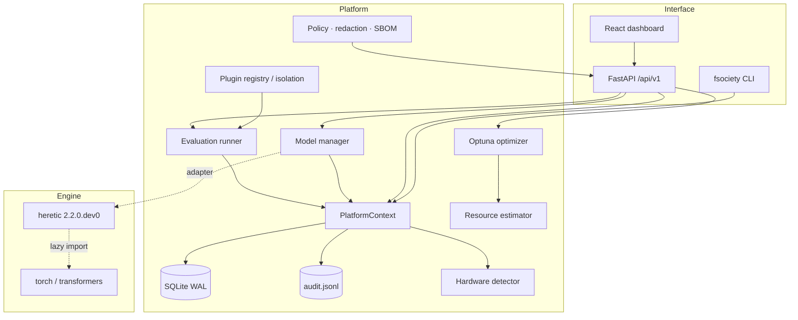
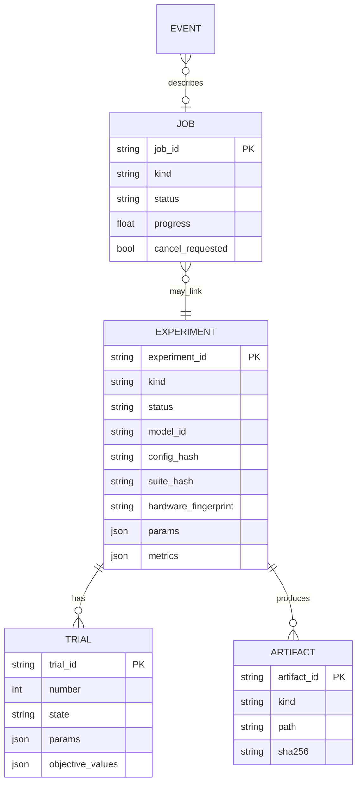

# 02 — ARCHITECTURE SPECIFICATION

**Status:** implemented baseline (verified against source as of this release)
**Scope:** FSOCIETY AI platform layer; the Heretic engine is a preserved dependency, not a fork.

---

## 1. Context and constraints

The repository was, before this work, the upstream Heretic 2.2.0.dev0 tree with no platform layer. The platform must therefore satisfy two opposing constraints:

1. **Preserve** the engine: import path `heretic`, CLI `heretic`, `config*.toml` keys, scorer/modifier plugin contracts, ARA/abliteration, reproducibility manifests.
2. **Evolve** into a platform whose core works on machines without torch, because hardware detection, model inventory, planning, experiments, API and dashboard do not need the engine.

The resolution is a *sidecar architecture*: `fsociety` imports `heretic` lazily, never edits it, and exposes engine capabilities through adapters. One distribution (`fsociety-ai`) ships both packages and keeps the `heretic` console script.



---

## 2. Component contracts

### 2.1 `PlatformContext` (composition root)

Owns `PlatformSettings`, `Workspace`, `ExperimentStore`, `AuditLogger`, and a TTL-cached `HardwareProfile`. Exposes `engine_status()`, `system_info()` and `close()`. CLI and API share this object; API caches heavier components (`ModelManager`, `SuiteRegistry`, `EvaluationRunner`, `PluginRegistry`) on `app.state`.

### 2.2 Settings and paths

`PlatformSettings` (pydantic-settings) merges defaults ← TOML ← `FSOCIETY_*` env. It validates CORS origins (no `*`), trusted repos (`org/name`), API key secrecy (`SecretStr`). All mutable state lives under `Workspace` (`data/`, `models/`, `exports/`, `reports/`, `logs/`, `plugins/`, `cache/`, `audits/`). `safe_join` resolves symlinks before checking containment, so a symlink inside the workspace cannot expose `/etc`.

### 2.3 Hardware detection

Sources and provenance per value:

| Source | Method | Confidence |
| :--- | :--- | :--- |
| CPU | `py-cpuinfo`, `/proc/cpuinfo`, `platform` | measured |
| RAM | `psutil`, `/proc/meminfo` fallback | measured |
| NVIDIA | `nvidia-smi --query-gpu=... --format=csv` | measured (driver) |
| AMD | `rocm-smi --json` | measured (driver) |
| Torch CUDA/ROCm/MPS | lazy `torch` probe | measured (runtime) |
| MPS availability | torch only; never inferred from OS | measured / unknown |

`detection_mode` is `measured` only when RAM and CPU identity are known; otherwise `partial`. `fingerprint` hashes stable capability fields only (excluded: timestamps, free memory, profile id). Driver availability and runtime availability are separate keys (`cuda_driver` vs `cuda_torch`).

### 2.4 Resource estimator

Pure functions; no hardware probing. Inputs: `ModelInfo` metadata, `EstimationRequest`, optional `HardwareProfile`.

```
weights      = params × bytes_per_param(mode) × 1.02
kv_cache     = 2 × layers × kv_heads × head_dim × seq × batch × kv_bytes
activations  = batch × seq × (4·hidden + 2·intermediate + 2·seq) × elem × factor
overhead     = accelerator_context × GPUs (or CPU runtime) + 8% fragmentation
```

`fits` compares the total against `max(accelerator_total) × (1 − reserve)` or currently available RAM. On failure, the planner enumerates dtype/quantization fallbacks at reduced sequence length and returns an actionable recommendation. Every estimate returns its assumptions and `kind="estimate"`; it is never presented as a measurement.

### 2.5 Model manager

Metadata extraction without torch:

* `config.json` → architecture, layers, heads, KV heads, hidden/intermediate/vocab/context, dtype hints, MoE, multimodal, `auto_map` (remote code).
* `safetensors` headers → **exact** parameter count (read 8-byte LE length + JSON; sum tensor shape products), shard index support.
* PyTorch `.bin` without torch → config-based estimate, explicitly `metadata_source="estimated"` with a warning.
* HF cache layout → `models--org--name/snapshots/<commit>`, `refs/*`.
* Integrity → sha256 per file + manifest verification; GGUF detected but not parsed for parameters (documented).

Hub downloads are explicit: revision resolved and returned, weights require `confirm_weights=True`.

The Heretic adapter writes a validated Heretic 2.x TOML config, invokes `python -m heretic.main` with an argv list (no shell), and enforces the platform trust policy. It does not reimplement modification.

### 2.6 Optimizer

`SearchSpace` (float/int/categorical, log/step/choices) maps directly onto Optuna suggestions. `Optimizer.run()` creates an `ExperimentRecord`, runs a seeded TPE/Random sampler, persists every `TrialRecord`, supports objective failure isolation (failed trial continues; all-failed raises), cooperative cancellation, and a progress callback. The HTTP-facing objective is a fixed analytical memory model (`optimizer/resource_objective.py`) — no arbitrary code execution. Python callers (plugins, scripts) may pass any objective callable.

### 2.7 Evaluation

* **Suites** are original, small JSON files with provenance and limitations; hash computed over canonical JSON and verified on load. They are smoke suites, *not* official MMLU/GSM8K/HumanEval.
* **Graders** are deterministic functions returning `(score, passed, details)` with a grader version; malformed outputs produce zero scores rather than exceptions.
* **Backends** implement `generate(prompts, max_new_tokens)`: Transformers (lazy, seeded, deterministic decode), llama.cpp (lazy), and `CallableBackend` as an integration point. No fake backend ships.
* **Runner** records model identity, backend, suite hash, config hash, seed, hardware fingerprint, software versions, duration, peak RSS, per-item results, metrics and category metrics. Failures are per item.
* **Reports** are atomic JSON + Markdown under `workspace/reports`, registered as artifacts.
* **Regression** refuses comparability when suite/config/grader differ; hardware mismatch is a warning for accuracy metrics; per-item regressions and deltas drive the verdict.

### 2.8 Plugins

Manifest = name, version, API version, kind, description, author, license, dependencies, permissions. Discovery: trusted builtins are imported in-process; workspace `.py` files and third-party entry points are imported **inside the isolation worker** (internal `discover_plugins` mode) and only metadata returns to the host, so module-level payloads do not run in the API/CLI process. Validation checks contract, API version, permission allowlist and dependency importability. Execution runs in a fresh subprocess (JSON on stdin/stdout) with env allowlist, timeout, output cap, new session/process-group kill and optional `unshare -n`; the applied isolation level is reported. `PluginRegistry.load()` and `allow_in_process=True` are explicit host-import escape hatches for trusted code.

Example scorers (`CodeQuality`, `Reasoning`, `SpanishLanguage`, `Hallucination`, `ModelIntegrity`, `BehavioralRegression`, `DefensiveCybersecurity`) are documented heuristics, not classifiers.

### 2.9 Persistence

SQLite with WAL, foreign keys, `schema_meta.version`, indices. Tables: `experiments`, `trials`, `jobs`, `events`, `artifacts`. Writes serialized by an `RLock`; connections shared with `check_same_thread=False`. One `ExperimentStore` per process context; API jobs write through the same instance. Schema upgrades are version-gated (fail closed rather than corrupt).

### 2.10 HTTP API

| Area | Endpoints |
| :--- | :--- |
| Public | `GET /health`, `GET /version` |
| System | `GET /system`, `/system/engine`, `/system/workspace`, `/hardware`, `/events`, `/settings` |
| Models | `GET /models`, `POST /models/scan`, `GET /models/inspect`, `GET /models/estimate`, `POST /models/verify` |
| Jobs | `POST /optimization/jobs`, `POST /evaluation/jobs`, `GET /jobs`, `GET /jobs/{id}`, `POST /jobs/{id}/cancel` |
| Experiments | `GET /experiments`, `/experiments/{id}`, `/trials`, `/artifacts`, `/report` |
| Evaluation | `GET /evaluation/suites`, `/evaluation/suites/{id}`, `/evaluation/reports/{id}`, `POST /evaluation/compare` |
| Ecosystem | `GET /plugins`, `POST /plugins/reload`, `POST /plugins/{name}/run`, `GET /exports`, `POST /exports/bundle` |
| Security | `GET /security/policy`, `/security/audit`, `/security/findings`, `/security/sbom`, `/security/dependency-audit` |

Middleware order (outermost first): TrustedHost → RequestContext (security headers, request ID) → rate limit → body size. Auth is a router-wide dependency except health/version. Errors are `{"error":{code,message,details?,hint?,request_id}}`; unhandled exceptions never expose tracebacks. API versioning is by path (`/api/v1`).

### 2.11 Dashboard

React 19 + TypeScript strict + Vite, no UI/chart libraries. Design tokens centralized in CSS variables; all data from `/api/v1`; loading/empty/error on every view; job polling pauses when the tab is hidden; API key held in `sessionStorage` and sent as `X-API-Key`. The production build is served by FastAPI with SPA fallback; assets are same-origin, so no CORS is needed.

---

## 3. Data model (principal entities)



---

## 4. Compatibility strategy

| Surface | Strategy |
| :--- | :--- |
| `import heretic` | untouched package |
| `heretic` CLI | console script preserved |
| Heretic 2.x config | untouched; platform adapter writes valid keys only |
| Heretic plugins | untouched; platform plugins are a separate contract |
| `heretic-llm` distribution | superseded by `fsociety-ai`; documented in migration guide (uninstall old distribution first) |
| Reproducibility manifests | untouched |

Breaking changes are limited to packaging: the distribution name changes and the build backend becomes hatchling (needed to ship two top-level packages). This is documented; the import/CLI/config/plugin contracts remain.

---

## 5. Deployment

* **Local**: `uv sync --all-extras`, `fsociety serve`, open `http://127.0.0.1:8000`.
* **Lightweight API host**: install `fsociety-ai --no-deps` + `[api]` dependencies; engine features fail with actionable errors.
* **Container**: CPU image (Dockerfile) runs the API/dashboard; engine/GPU images are built from the same base with a CUDA torch index. The container runs as a non-root user, workspace volume, healthcheck against `/api/v1/health`.
* **Remote exposure**: requires `FSOCIETY_API_KEY`, explicit `api_allowed_hosts`, TLS terminated by a reverse proxy; docs recommend loopback or a private network.

## 6. Known architectural limitations

1. Plugin isolation is process-level, not a container sandbox.
2. Rate limiting and job execution are per-process; scale-out needs a shared queue/limiter.
3. Analytical estimates are not runtime measurements; real engine benchmarks require GPU hardware absent from the validation host.
4. GGUF conversion/inference is delegated to llama.cpp tooling; the platform only plans/executes when those tools exist.
5. The bundled evaluation suites are small smoke tests, not leaderboard-comparable benchmarks.
