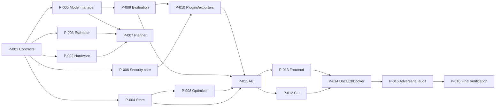

# 03 — IMPLEMENTATION PLAN

**Method:** dependency-ordered atomic tasks, each verifiable in isolation. Tasks owned by distinct agents do not share files. The engine (`src/heretic`) is read-only throughout.

## Dependency graph

| ID | Task | Owner | Prereq | Files (primary) | Outcome | Verification | AC |
| :--- | :--- | :--- | :--- | :--- | :--- | :--- | :--- |
| P-001 | Contracts, errors, settings, paths, hashing, audit log | builder | — | `core/models.py`, `errors.py`, `config.py`, `paths.py`, `logging.py`, `utils/hashing.py`, `security/redaction.py` | Validated shared types + jailed paths | `tests/unit/test_foundation.py` | AC-19,24,27 |
| P-002 | Hardware detection | builder | P-001 | `core/hardware.py` | Provenance-aware profile | mocked CPU/NVIDIA/MPS tests | AC-04..06 |
| P-003 | Resource estimator | builder | P-001 | `core/estimator.py` | Analytical memory model + recommendations | numeric tests | AC-07..09 |
| P-004 | Persistence | builder | P-001 | `experiments/store.py` | WAL store with concurrency test | store tests | AC-19,20 |
| P-005 | Model manager + engine adapter | builder | P-001, P-002 | `core/model_manager/*`, `core/engine.py` | Torch-free metadata, exact safetensors params, integrity, safe engine invocation | `test_model_manager.py`, `test_engine_adapter.py` | AC-10..12 |
| P-006 | Security core | builder | P-001 | `security/*`, `plugins/isolation.py` | Policy, redaction, SBOM, headers, isolation | `tests/security` | SEC-01..04 |
| P-007 | Planner | builder | P-002,3,5 | `optimizer/planner.py`, `optimizer/resource_objective.py` | Fit validation + shared objective | planner tests | AC-14 |
| P-008 | Optimizer | builder | P-004, P-007 | `optimizer/{space,engine}.py` | Seeded Optuna, persistence, cancel | optimizer tests | AC-13..15 |
| P-009 | Evaluation | builder | P-004, P-006 | `evaluation/*` | Suites, graders, backends, reports, regression | evaluation tests | AC-16..18 |
| P-010 | Plugins & exporters | builder | P-006 | `plugins/*`, `exporters/*` | Versioned plugins, isolation, bundles, GGUF boundary | plugin/exporter/security tests | AC-21..23 |
| P-011 | API | orchestrator | P-004,8,9,10 | `interfaces/api/*` | Auth, jobs, structured errors, SPA | `tests/api` | AC-28..30 |
| P-012 | CLI | orchestrator | P-005..10 | `interfaces/cli/main.py` | Operational command surface | CLI tests + manual JSON runs | AC-34 |
| P-013 | Dashboard | builder + ui-artisan | P-011 contract | `frontend/**` | 10 sections, real data, states | `npm run typecheck`, `npm run build` | AC-31..33 |
| P-014 | Docs, CI, Docker | orchestrator | all | `README.md`, `docs/**`, `.github/workflows/ci.yml`, `deployment/**` | Reproducible delivery | doc review, docker build if available | AC-35,36 |
| P-015 | Adversarial audit | redteam-auditor | all | `.factory/SECURITY_AUDIT.md` | Findings + remediation | audit checklist | Exit gate |
| P-016 | Final verification & report | qa-verifier + orchestrator | P-015 | `docs/reports/FINAL_PROJECT_REPORT.md` | Evidence-based release statement | full test sweep | AC-36 |

## Sequencing rules

1. No agent edits another agent's files; conflicts are resolved by the orchestrator.
2. Each task lands with tests; a task without executable verification stays `[~]`.
3. UI work starts only after the API contract is fixed (P-011), never in parallel with backend contract churn.
4. Every failure is retried at most three times (`Retries: X/3`) and then replanned by the architect.
5. The final audit and report may only claim what was executed. Unavailable hardware (CUDA/MPS) and unavailable tools (Docker, pip-audit) are reported as skipped/unavailable with the exact reason.
